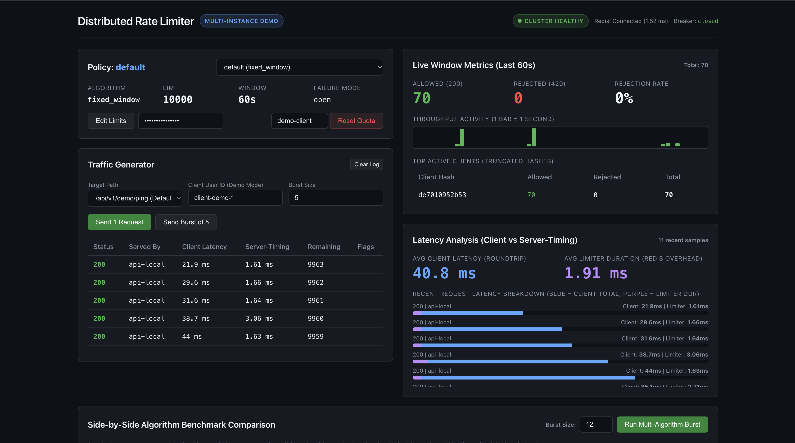
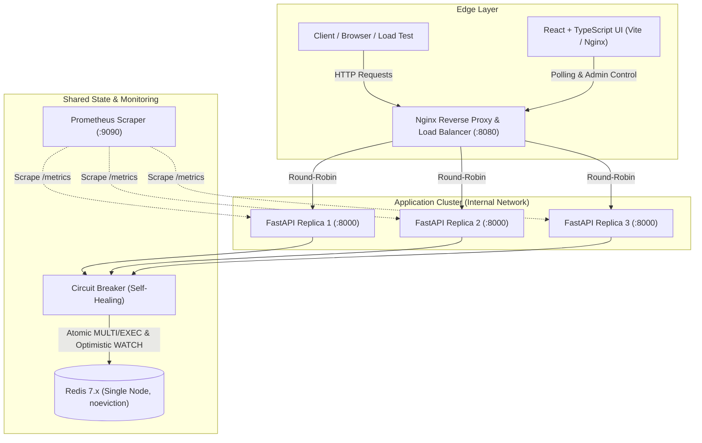
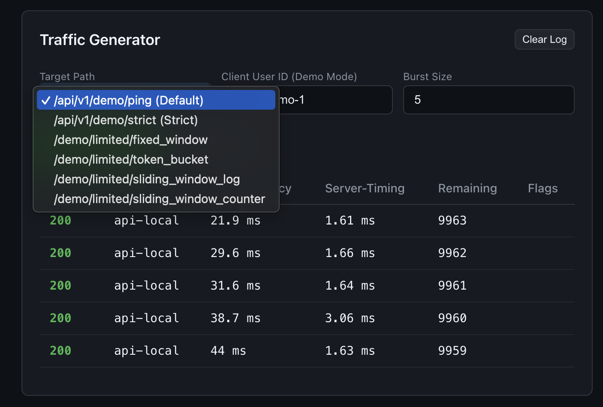
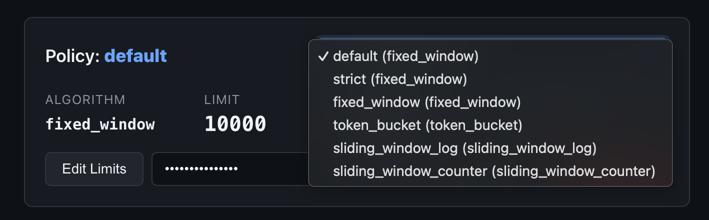
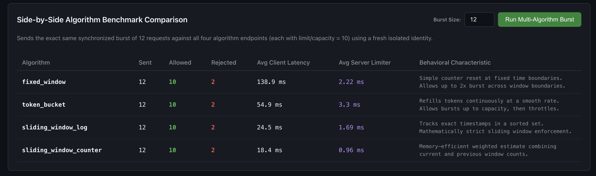

# Distributed API Rate Limiter

[](https://github.com/television-x/Rate-Limiter/actions/workflows/ci.yml)
[](https://fastapi.tiangolo.com)
[](https://redis.io)
[](https://react.dev)
[](https://www.typescriptlang.org)
[](https://www.docker.com)
[](LICENSE)

A production-grade, concurrency-safe distributed rate limiter demonstrating **four rate limiting algorithms**, synchronized across multiple API replicas via **Redis 7.x**, protected by an automated **Circuit Breaker**, monitored in real time with **Prometheus**, load-balanced via **Nginx**, and visualized through an interactive **React + TypeScript dashboard**.



---

## Architecture Overview



---

## Key Features

1. **Four Interchangeable Algorithms:**
   - **Fixed Window Counter:** High throughput $\mathcal{O}(1)$ atomic increments via `MULTI(INCR, PEXPIRE)/EXEC`.
   - **Sliding Window Log:** Strict precision without boundary bursts using sorted sets (`ZREMRANGEBYSCORE`, `ZCARD`, `ZADD`) under optimistic locking (`WATCH`).
   - **Sliding Window Counter:** Low-memory Cloudflare-style weighted approximation blending current and previous window totals.
   - **Token Bucket:** Smooth flow with configurable burst capacity and refill rates via optimistic transactions.
2. **True Distributed State Enforcement:**
   - Multiple API instances share a single Redis backend. Verified by end-to-end tests: a quota of $L=10$ allows **exactly 10 requests** total across all 3 replicas, contrasting with isolated local memory allowing $3 \times L = 30$.
3. **Resilience & Circuit Breaking:**
   - Automatic 3-state Circuit Breaker (`CLOSED` -> `OPEN` -> `HALF_OPEN`).
   - Configurable per-policy failure handling: `open` (degraded allow), `closed` (HTTP 503), or `local_fallback` (in-memory per-instance fallback with explicit `X-RateLimit-Status: degraded`).
4. **Dynamic Policy Overrides:**
   - Live admin API to modify rates at runtime without server restarts or redeployment.
   - 2-second in-memory version caching to eliminate database overhead on steady-state queries.
5. **Observability & Standardized Headers:**
   - Low-cardinality Prometheus metrics emitted for decisions, storage operations, latencies, and circuit breaker states.
   - RFC-compliant HTTP response headers: `X-RateLimit-Limit`, `X-RateLimit-Remaining`, `X-RateLimit-Reset`, `Retry-After`, and `Server-Timing: limiter;dur=<ms>`.
6. **Interactive Dashboard:**
   - Real-time React 18 + TypeScript SPA with live counter charts, health status badge, on-the-fly traffic generator, and side-by-side algorithm comparison view.

---

## Rate Limiting Algorithms Comparison

| Algorithm | Redis Mechanism | Space per Key | Time Complexity | Strictness | Boundary Burst Protection | Best Used For |
|---|---|---|---|---|---|---|
| **Fixed Window** | `MULTI(INCR, PEXPIRE)` | $\mathcal{O}(1)$ | $\mathcal{O}(1)$ | Exact within window | ❌ Vulnerable (up to $2\times L$) | Internal high-throughput microservices |
| **Sliding Log** | `WATCH` + `ZREMRANGE` + `ZADD` | $\mathcal{O}(N)$ | $\mathcal{O}(\log N + M)$ | 100% Strict | ✅ Completely protected | Sensitive endpoints (auth, checkout, passwords) |
| **Sliding Counter** | `MULTI(INCR, GET, PEXPIRE)` | $\mathcal{O}(1)$ | $\mathcal{O}(1)$ | ~99% Approximation | ✅ Smooths boundary bursts | High-volume public APIs, CDNs (Cloudflare style) |
| **Token Bucket** | `WATCH` + `HMGET` + `HSET` | $\mathcal{O}(1)$ | $\mathcal{O}(1)$ | Exact vs refill bound | ✅ Allows controlled burst | Developer APIs (Stripe, AWS standard), background queues |

For detailed algorithmic specifications, state keys, and complexity bounds, see [docs/algorithms.md](docs/algorithms.md).

---

## Interactive Dashboard Preview

The application includes a built-in React 18 + TypeScript web cockpit designed to test, monitor, and visualize distributed rate limiting concepts live in your browser:

### 1. Real-Time Traffic Generator & Response Log
Test API routes by firing single requests or configurable bursts with custom client identities. Inspect response codes (HTTP 200 vs 429 Too Many Requests), server node routing (`X-Served-By`), client round-trip latency, remaining quota, and internal Redis overhead (`Server-Timing`).



### 2. Dynamic Policy Selection & Live Limits
Switch between rate-limiting policies on the fly or update capacity, refill rates, and time windows via the Admin API. All backend replicas automatically synchronize updates within 2 seconds without requiring application restarts.



### 3. Side-by-Side Algorithm Comparison
Fire an identical synchronized burst of requests across all four algorithms simultaneously to visually compare allowed vs. rejected counts, client latency, and algorithmic behavioral characteristics in real time.



---

## Measured Performance & Benchmark Results

All figures below are directly extracted from the reproducible benchmark run in [docs/benchmarks.md](docs/benchmarks.md) (committed raw output in `benchmarks/results/`):

- **Baseline Limiter Overhead:** **0.58 ms** median server evaluation duration (`Server-Timing: limiter;dur=0.58`).
- **Throughput Under Load:** Sustained **299.9 RPS** across 1,500 requests with zero dropped requests and sub-2ms client latency ($p_{50} = 1.98\text{ ms}$).
- **Single Hot-Key Stress Test (Token Bucket):** Fired 750 requests at 150 RPS on a single client key (Capacity: 10, Refill: 2.0/s over 5.0 seconds).
  - **Allowed:** **Exactly 19 requests** ($10 \text{ initial} + 9 \text{ refilled}$).
  - **Rejected (HTTP 429):** **731 requests.**
  - **Errors / Token Leaks:** **0.**

---

## Quick Start

### Prerequisites
- Docker & Docker Compose
- Python 3.12+ (for local development)
- Node.js 20+ (for frontend development)

### 1. Launch with Docker Compose

Spin up the entire cluster (3 API replicas, Nginx load balancer, Redis, Prometheus, and React Dashboard):

```bash
docker compose up -d --build
```

Access the services:
- **Frontend Dashboard:** [http://localhost:3000](http://localhost:3000) (or via Nginx on port 8080)
- **API (Load-Balanced via Nginx):** [http://localhost:8080/api/v1/demo/ping](http://localhost:8080/api/v1/demo/ping)
- **Direct Backend Replicas:** `localhost:8001`, `localhost:8002`, `localhost:8003`
- **Prometheus Dashboard:** [http://localhost:9090](http://localhost:9090)
- **Health Checks:** [http://localhost:8080/healthz](http://localhost:8080/healthz) and [http://localhost:8080/readyz](http://localhost:8080/readyz)

To shut down:
```bash
docker compose down
```

---

### 2. Local Development Setup

#### Backend:
```bash
cd backend
python3 -m venv .venv
source .venv/bin/activate
pip install -e ".[dev]"

# Run tests
pytest -m "unit or contract or api"

# Start standalone dev server
uvicorn app.main:app --host 127.0.0.1 --port 8000 --reload
```

#### Frontend:
```bash
cd frontend
npm install
npm test
npm run dev
```

---

## API Endpoints Reference

| Method | Path | Auth | Purpose | Response Codes |
|---|---|---|---|---|
| `GET` | `/healthz` | None | Liveness check (process up) | 200 |
| `GET` | `/readyz` | None | Readiness check (Redis connectivity verified) | 200, 503 |
| `GET` | `/health/dependencies` | Admin Bearer | Inspects Redis latency & circuit breaker state | 200, 401 |
| `GET` | `/metrics` | Internal | Prometheus metrics (blocked by Nginx externally) | 200 |
| `GET` | `/api/v1/demo/ping` | None | Default rate-limited endpoint (60 req / 60s) | 200, 429, 503 |
| `GET` | `/api/v1/demo/strict` | None | Strict demo endpoint (5 req / 10s) | 200, 429 |
| `GET` | `/api/v1/demo/limited/{algo}`| None | Endpoint targeting a specific algorithm | 200, 429, 404 |
| `GET` | `/api/v1/policies` | None | Read-only listing of all active policies | 200 |
| `PUT` | `/api/v1/admin/policies/{id}` | Admin Bearer | Dynamically update policy limits at runtime | 200, 401, 422 |
| `GET` | `/api/v1/admin/stats` | Admin Bearer | Per-second throughput and top-N client distribution | 200, 401 |
| `POST`| `/api/v1/admin/reset` | Admin Bearer | Clear rate limit for a specific client key | 204, 401 |

For complete OpenAPI schemas and response examples, refer to [docs/openapi.json](docs/openapi.json).

---

## Architectural Decision Records (ADRs)

Key architectural choices are formally documented in `docs/adr/`:
- **[ADR 0001: No-Lua Strategy](docs/adr/0001-no-lua.md):** Architectural rationale for plain Redis primitives, transactions, and optimistic concurrency without Lua scripts.
- **[ADR 0002: Storage Contract & Time Source](docs/adr/0002-storage-contract-and-time-source.md):** Capability-based storage abstraction and Redis `TIME` authoritative clock.
- **[ADR 0003: Strict Sliding Log & Optimistic Locking](docs/adr/0003-strict-sliding-log-and-optimistic-locking.md):** Avoiding phantom increments and guaranteeing zero false rejections.
- **[ADR 0004: Dependency vs Middleware Separation](docs/adr/0004-dependency-vs-middleware.md):** Clean route-level rate limiting via FastAPI dependencies vs cross-cutting middleware.
- **[ADR 0005: Identity Trust & Client Resolution](docs/adr/0005-identity-trust-and-client-resolution.md):** Preventing IP spoofing through strict trusted-proxy boundaries.
- **[ADR 0006: Failure Handling & Circuit Breaker](docs/adr/0006-failure-policy-and-circuit-breaker.md):** Self-healing storage resilience, fail-open vs fail-closed strategies.
- **[ADR 0007: Polling vs SSE/WebSockets for Dashboard](docs/adr/0007-polling-vs-sse-and-websockets.md):** 1-second polling with AbortController for reliable stateless dashboard updates.

---

## Project Structure

```
.
├── AGENTS.md                          # Comprehensive implementation specification & phases
├── Makefile                           # Build, lint, test, benchmark automations
├── docker-compose.yml                 # Multi-instance topology (Nginx, 3 APIs, Redis, Prometheus)
├── docs/                              # Project documentation & ADRs
│   ├── adr/                           # Architectural Decision Records (0001 - 0007)
│   ├── algorithms.md                  # Deep-dive algorithmic specifications
│   ├── benchmarks.md                  # Measured benchmark analysis & percentiles
│   ├── design.md                      # System architecture, layering & inventory
│   ├── openapi.json                   # Frozen OpenAPI 3.1 specification
│   └── operations.md                  # Production operations & runbook
├── backend/                           # Python 3.12 / FastAPI Core
│   ├── policies.yaml                  # Default baseline rate limiting policies
│   ├── app/
│   │   ├── api/                       # HTTP routes, dependencies, RFC 7807 error handlers
│   │   ├── core/                      # Domain models, algorithms, storage contracts, clock
│   │   ├── metrics/                   # Prometheus observer adapter
│   │   ├── middleware/                # Server-Timing, Request ID, X-Served-By middleware
│   │   └── services/                  # Rolling stats service & dynamic policy cache
│   └── tests/                         # Unit, contract, integration, concurrency & E2E tests
├── frontend/                          # React 18 + TypeScript Dashboard (Vite)
│   ├── src/
│   │   ├── api/                       # Typed API client
│   │   ├── components/                # PolicyPanel, LiveCounters, LatencyChart, TrafficGenerator
│   │   └── hooks/                     # usePolling hook with exponential backoff
└── infra/                             # Infrastructure configurations
    ├── nginx/                         # Nginx load balancer reverse proxy
    └── prometheus/                    # Prometheus scraping configuration
```

---

## License

This project is licensed under the MIT License - see the [LICENSE](LICENSE) file for details.

